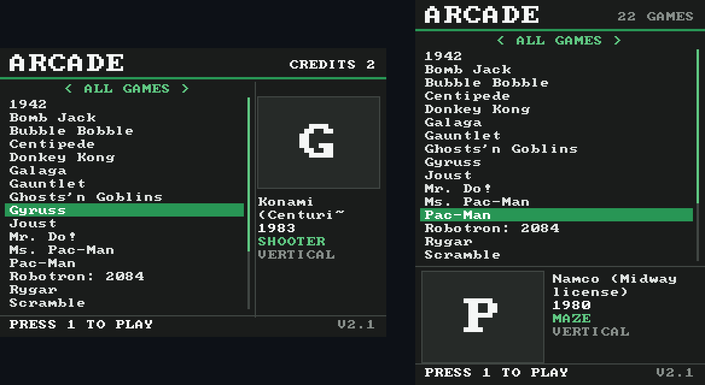
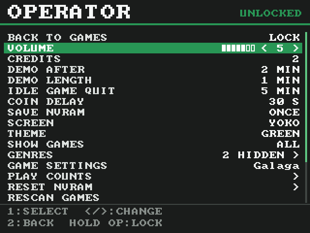
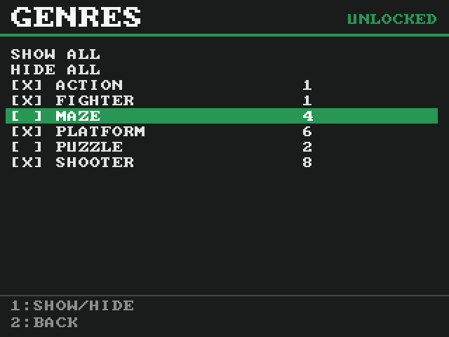
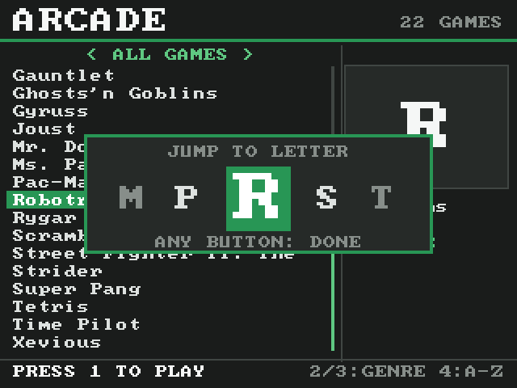
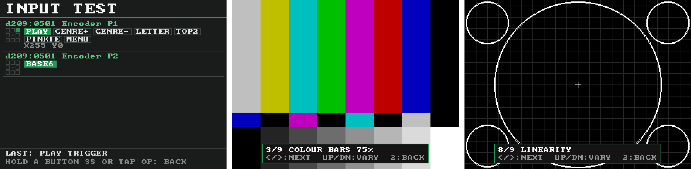
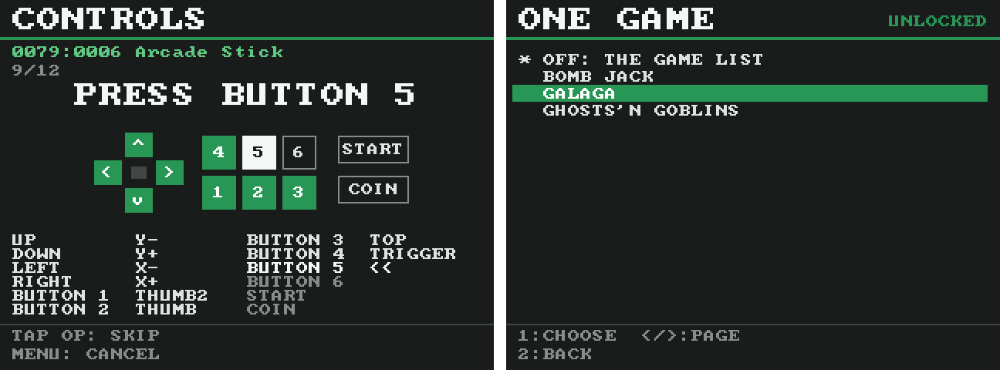

# MisterOperator

**A locked-down, arcade-only frontend for MiSTer FPGA cabinets, built for retrobar operators.**

Players get a simple game list and one button that always brings them back to it. The
operator gets a hidden button that opens a service menu in the same look. Nothing else on
the MiSTer is reachable while the cabinet is locked.

**Version 2.4** · for 15 kHz CRTs and HDMI · USB arcade encoders · nothing to install on
the MiSTer besides the kiosk · **[Manual](MANUAL.md)**

## Features

**For players**
- A full-screen list of arcade games (`.mra` and `.mgl`), with genre, year, maker and box art
- **One press of MENU** quits any game straight back to the list
- Buttons 2 and 3 step through genres; Button 4 jumps to a letter
- **Coins put in on the list are held** as credits and go into the game once it has loaded
- The same panel layout (buttons 1–6) in every game

**For operators**
- Hold the **OPERATOR** button for a themed **operator menu**: volume, free credits, demo
  and idle timers, which games and genres are listed, screen and theme, play counts,
  NVRAM, a game's DIP switches, updates and reboot
- **Monitor and input tests** in the operator menu: grid, convergence, colour bars,
  black/white level, grey ramps, purity, overscan, linearity and sharpness patterns, and a
  live tester for every button and stick
- **Controller setup wizard**: stick, buttons 1–6, player Start and Coin, one press each
- **Single-game mode**: lock the cabinet to one game from power-on until OPERATOR is held
- **Attract mode** plays demos when the cabinet is idle; **idle games quit** by themselves
- Game settings and high scores (NVRAM) are saved on every quit, so no CMOS errors on games
  like NBA Jam, and **Autosave Hiscores** is switched on in every core that has it
- **Updates over the internet**: from the operator menu, the Scripts menu, or automatically
- Starts locked after a power cut, and restarts itself if it ever stops

**For the cabinet**
- Landscape (YOKO) or vertical (TATE) layouts, and YOKO-only or TATE-only game lists
- Dark grey and green theme, or phosphor or classic, with every colour adjustable
- Optional **kiosk build of the MiSTer main program**: no MiSTer menu at boot or between
  games, silent NVRAM saves, high-score autosave in every core, and a MiSTer menu that can't be opened while locked

  
  
  

  

  

## Install

1. **Get the files onto the SD card**, either:
   - **from the internet:** copy [`Scripts/update_arcade_kiosk.sh`](Scripts/update_arcade_kiosk.sh)
     to `/media/fat/Scripts/` and run **update_arcade_kiosk** from the MiSTer's Scripts
     menu. It downloads the latest release and installs it. (This needs the repo to be
     public.)
   - **or by hand:** download `MisterOperator_v<version>.zip` from
     [Releases](../../releases/latest), copy its `arcade_kiosk` and `Scripts` folders to the
     root of the SD card, and run **install_arcade_kiosk** from the Scripts menu.
2. Copy the lines from `arcade_kiosk/MiSTer_ini_additions.txt` into `/media/fat/MiSTer.ini`.
   `fb_terminal=1` is required; the `[menu]` section gives the list 15 kHz output.
3. In the stock MiSTer menu, give the OSD **Menu** function to the button that will be
   the player MENU button. (Map the rest of the encoder there too, or later with
   **Controller setup** in the operator menu.)
4. Reboot. The list asks you to press the **player MENU** button, then the **OPERATOR**
   button. Done.

Then, optionally, open the operator menu and install the kiosk build of the MiSTer main
program (**MiSTer main**). The [manual](MANUAL.md#2-installing) has the details and a
first-boot checklist.

## Controls

| Control | On the game list | In a game | Unlocked |
|---|---|---|---|
| Stick | Move; left/right jumps a letter | game | normal |
| Button 1 or Start | Play | game | normal |
| Button 2 / 3 | Next / previous genre | game | normal |
| Button 4 | Letter jump | game | normal |
| Coin | Add a credit | coin | coin |
| Player MENU | — | **Quit to the list** | Opens the MiSTer menu |
| OPERATOR (hold 1.5 s) | Operator menu | Quit to the operator menu | Back to the operator menu |

## Updating

- **Operator menu → Update kiosk:** press once to check, again to install.
- **Scripts menu → update_arcade_kiosk**, or `arcadekiosk.py --update` over SSH.
- **Automatically:** set `auto_update = 1` in `kiosk.ini`.

Updates keep your settings, credits, play counts and box art, and back up the version they
replace (`--rollback` goes back). See [Updating](MANUAL.md#7-updating) in the manual.

## Documentation

The **[manual](MANUAL.md)** covers everything: installing, the operator menu item by item,
every `kiosk.ini` setting, vertical monitors, coins, NVRAM, the standard button layout,
the kiosk build of the MiSTer main program, updating, the command line, troubleshooting
and the version history. A copy is on the SD card as `arcade_kiosk/MANUAL.md`.

## Repository

| Path | |
|---|---|
| `arcade_kiosk/` | The kiosk, as it goes on the SD card (`/media/fat/arcade_kiosk/`) |
| `Scripts/` | Installer and updater for the MiSTer Scripts menu |
| `fork/` | The patch behind the kiosk build of the MiSTer main program ([details](fork/README.md)) |
| `tests/` | Off-hardware tests |
| `docs/` | Screenshots |
| `MANUAL.md` | The manual |

**Tests:** `tests/run_tests.sh` (Python 3 only). They fake the MiSTer's command pipe, core
name, framebuffer and controllers, and cover the game list, filters, controls, operator
menu, coins, attract mode, NVRAM, screen rotation, button layouts, the kiosk build and
updates.

**Releases:** change `VERSION` in `arcade_kiosk/arcadekiosk.py` and push to `main`. GitHub
Actions runs the tests, builds `MisterOperator_v<version>.zip` and publishes the release
that the updater installs. The release copies `MANUAL.md` into `arcade_kiosk/` so the
manual is on the SD card too.

The kiosk build of the MiSTer main program is built from
[alex-acsit/Main_MiSTer](https://github.com/alex-acsit/Main_MiSTer), whose own GitHub
Actions publish each build as its `kiosk-latest` release.

## Licence

GPL-3.0, see [LICENSE](LICENSE). The bundled 8×8 font (`font8x8.py`) is public domain
(font8x8 by Daniel Hepper, from IBM public-domain VGA fonts).
